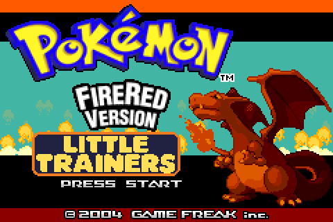
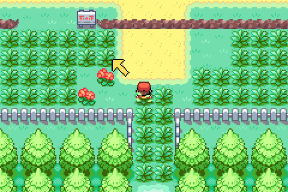
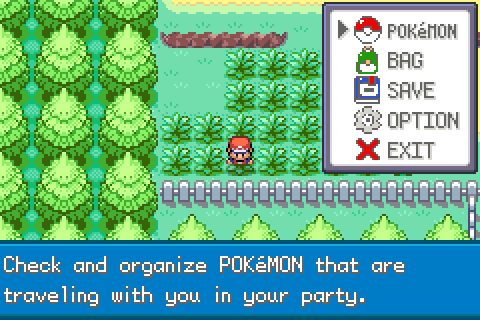
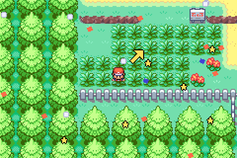

<div align="center">


# Pokémon: Little Trainers

**Explore Kanto with easier game modes, guided navigation and pictures that support reading.**


[Download a patch](https://github.com/mckenna654/pokemon-little-trainers/releases) ·
[Getting started](#getting-started) · [Difficulty modes](#difficulty-modes) ·
[Known issues](docs/KNOWN_ISSUES.md)

</div>

Pokémon: Little Trainers is an unofficial modification of **Pokémon FireRed** that makes the
original adventure more approachable for younger players. It offers three difficulty modes,
including **Little Trainer, designed for children aged 3–4**, with simpler battle choices,
easier catching and guidance through the main story.

The aim is to reduce frustration while keeping the choices, exploration and sense of discovery
that make Pokémon enjoyable. Parents and carers can choose the level of assistance that suits
their child.

### Pictures support reading

**The artwork is a reading aid, not a replacement for reading.** Pictures provide visual cues
alongside written labels: a backpack accompanies **BAG**, the selected attack or action is named
beside the battle buttons, and ticks and crosses accompany **YES** and **NO**.

Story dialogue, signs and many menus remain written. Younger children may still need an adult
to read with them, explain unfamiliar choices and help with parts of the game. The suggested
ages describe the intended audience, rather than a guarantee of independent play.

## Screenshots

| Title screen | Story navigation | Battle interface |
| :---: | :---: | :---: |
|  |  |  |
| Catching | Start menu | Badge celebration |
|  |  |  |

## Difficulty modes

New games start in **Little Trainer** mode. Change the setting in **OPTION → MODE**.

| Mode | Intended audience | Experience |
| --- | --- | --- |
| **Little Trainer** | Ages **3–4**, with adult support as needed | The most assistance: illustrated battle buttons, one or two selected attacks, easier catching, reduced incoming damage and simplified puzzles. |
| **Junior Trainer** | Ages **5–6**, or players ready for more choices | Standard battle menus with easier catching, gentler battles, navigation guidance and automatic healing. Original puzzles remain. |
| **Classic Trainer** | Older children and adults who prefer the original challenge | Original-style battle and progression rules, with shared presentation changes. Navigation assistance and automatic healing are disabled. |

Modes can be changed during a play-through. Changes adjust the assistance available; they do
not undo story progress or restore puzzles already completed or opened.

See [the accessibility guide](docs/ACCESSIBILITY.md) for the detailed rules and differences
between modes.

## Features

Little Trainer mode includes:

- **Simpler battles:** illustrated action buttons, a recommended attack marker and fewer
  decisions each turn. Player attacks do not use up PP or miss through normal accuracy checks.
- **Easier catching:** five times the original catch odds, with free Poké Balls. Catching can
  still fail, particularly for rare and legendary Pokémon; weakening them improves the odds.
- **Gentler recovery:** automatic healing after battles, no money lost on defeat and a return
  to the last town visited.
- **Story guidance:** a directional arrow towards the next main-story objective, including
  diagonal directions where either route is suitable.
- **Clearer visual cues:** hearts for health, pictures alongside menu words and celebrations
  when badges are earned.
- **Less setup:** no name-entry or nickname questions, automatic move learning and supported
  field moves without teaching HMs once their requirements are met.
- **Simplified obstacles:** selected gym and story puzzles are opened or bypassed.

Junior Trainer retains several assists while restoring standard battle choices and puzzles.
The [changelog](CHANGELOG.md) documents the full set of changes.

## Getting started

**You need your own Pokémon FireRed (USA, Europe) v1.1 / Rev 1 ROM.** Downloads contain a
`.bps` patch, not the game. No original or modified ROM is distributed by this project.

1. **Check your ROM version.** The supported FireRed ROM is 16,777,216 bytes. Use the checksums
   in the release notes to confirm it is v1.1; file size alone does not identify the revision.
2. **Download the `.bps` file** from the
   [releases page](https://github.com/mckenna654/pokemon-little-trainers/releases).
3. **Apply the patch** using a BPS-compatible patcher such as
   [Rom Patcher JS](https://www.marcrobledo.com/RomPatcher.js/). Select your FireRed file as the
   ROM, select the downloaded `.bps` as the patch, then choose **Apply patch**.
4. **Open the resulting `.gba` file** in your GBA emulator.
5. **Start a new game.** Saves from the original FireRed are unsupported.

If patching fails, check the ROM revision and checksum against the release notes.

### Steam Deck installer — experimental

An optional installer locates your FireRed v1.1 ROM, downloads the newest patch and creates the
modified game. It also supports updating an existing installation.

<details>
<summary>Installation instructions</summary>

1. Switch to **Desktop Mode** and open **Konsole**.
2. Paste these two lines:
   ```bash
   curl -L -o ~/install-little-trainers.py https://raw.githubusercontent.com/mckenna654/pokemon-little-trainers/main/steamdeck/install-little-trainers.py
   python3 ~/install-little-trainers.py
   ```
3. Follow the prompts. To check for updates later, run the second command again.

The installer recognises common EmuDeck and RetroDECK GBA folders and is designed to preserve
existing saves. Add the game to Gaming Mode using your usual emulator setup, such as Steam ROM
Manager. Run `python3 ~/install-little-trainers.py --help` for command-line options.

</details>

**The installer has been tested on macOS, but has not yet been tested on a Steam Deck.**
Manual patching is also available using the steps above.

## Building from source

The project is built from the [pret/pokefirered](https://github.com/pret/pokefirered)
decompilation. This repository stores the project's changes as patches, alongside its tools,
tests, documentation and original artwork.

For macOS, Linux or Windows through WSL:

```bash
git clone https://github.com/mckenna654/pokemon-little-trainers.git
cd pokemon-little-trainers
scripts/setup.sh            # tools, pinned decomp source into game/, our patches applied
cp /path/to/your/firered.gba original-rom/firered-rev1.gba
scripts/verify-rom.sh       # must be FireRed (USA, Europe) v1.1
scripts/build.sh            # -> builds/Pokemon - Little Trainers.gba  and  .bps
scripts/test.sh             # unit tests + automated play-through in a headless emulator
```
Play `builds/Pokemon - Little Trainers.gba` in mGBA, RetroArch, Delta or another GBA emulator, or
apply `builds/Pokemon - Little Trainers.bps` to your own FireRed v1.1 ROM with any BPS patcher.

More: [docs/BUILD.md](docs/BUILD.md) · [docs/TESTING.md](docs/TESTING.md)

## Development status

**This is a development pre-release.** Automated testing has completed the main story from a
new game to the Hall of Fame, but hands-on testing with people remains limited. Testing has
used the headless mGBA 0.10.5 core; compatibility with other emulators and devices has not been
verified.

Party, bag and storage screens still rely on text. Some original item-toss and Pokémon-release
actions remain available, and the original story themes are retained. Adult supervision is
recommended for younger players. See [known issues](docs/KNOWN_ISSUES.md) and
[test results](docs/TESTING.md) for the current limitations.

Feedback is welcome through [GitHub Issues](https://github.com/mckenna654/pokemon-little-trainers/issues).
Please include the release version, emulator or device, steps to reproduce the problem and a
screenshot where useful. Do not upload ROMs or save files.

## Project documentation

| File | Purpose |
| --- | --- |
| [ROADMAP.md](ROADMAP.md) · [CHANGELOG.md](CHANGELOG.md) | Milestones and history |
| [docs/PROGRESS.md](docs/PROGRESS.md) | Current status, unverified items, next action |
| [docs/ARCHITECTURE.md](docs/ARCHITECTURE.md) | Repo design, source map, every change, licensing |
| [docs/ACCESSIBILITY.md](docs/ACCESSIBILITY.md) | Design rules for preschool players, parent checklist |
| [docs/GRAPHICS.md](docs/GRAPHICS.md) | Remaster strategy and asset attribution |
| [docs/BUILD.md](docs/BUILD.md) · [docs/TESTING.md](docs/TESTING.md) · [docs/KNOWN_ISSUES.md](docs/KNOWN_ISSUES.md) | Building, testing, limitations |
| [AGENTS.md](AGENTS.md) / [CLAUDE.md](CLAUDE.md) | Instructions for Claude sessions |

## Contributors

- **[Jake (@mckenna654)](https://github.com/mckenna654):** project concept, design direction and
  playtesting.
- **Claude / Claude Code (Anthropic):** game implementation, development tools, tests and
  documentation.
- **ChatGPT / Codex (OpenAI):** battle-button, Start-menu and title illustrations, plus a
  [source and design review](docs/REVIEW-2026-11-25.md).
- **[pret contributors](https://pret.github.io/):** the FireRed decompilation on which the project
  is built.

## Credits and legal

Pokémon and Pokémon FireRed are © Nintendo, Creatures Inc. and GAME FREAK inc. This is an unofficial,
non-commercial fan project with no affiliation. The decompilation is the work of the
[pret](https://pret.github.io/) contributors; mGBA (MPL-2.0) and Floating IPS (GPL-3.0) are used as
local build/test tools and are not redistributed. Never share ROM files.
