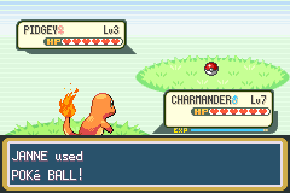

<div align="center">


# Pokémon: Little Trainers

**A preschool-friendly Pokémon FireRed modification: pictures that help with the words, an arrow
to follow, easy catching and nothing lost by losing.**


</div>

Little Trainers adapts Pokémon FireRed for children aged three to six: a child who cannot read yet
should be able to choose a Pokémon, explore, catch, battle, evolve and earn badges with very little
adult help. It is a real GBA ROM hack built from the
[pret/pokefirered](https://github.com/pret/pokefirered) decompilation, and it runs on any standard
GBA emulator.

**The pictures are there to help a child learn to read, not to replace reading.** The words stay
on screen beside them: the Start menu shows a backpack next to the word BAG, the battle buttons
show each attack's name beside its picture, and Yes and No keep their words next to the tick and
the cross. A child can play by the pictures today and pick up the words as they go. The story,
the signs and what people say are still written, for reading together.

| | | |
| :---: | :---: | :---: |
|  |  |  |
| The title screen | An arrow always shows the way | Pictures to press, hearts for health |
|  |  |  |
| One press to throw a ball | Pictures in the menu | Confetti for every badge |

## What is different from FireRed
- **Battles by picture:** one or two attacks chosen for the Pokémon, shown as big buttons, with a
  small star on the one that works best. No move lists, no PP, no missing.
- **An arrow to follow** from the bedroom to the Hall of Fame. It points diagonally when either
  of two directions is right.
- **Hearts instead of numbers**, healing after every battle, and nothing lost by losing.
- **Easy catching:** balls are free and never run out. Common Pokémon are caught almost every
  time; rare ones may take a few throws.
- **Pictures beside the words, not instead of them:** a child who cannot read yet can still get
  on, with no typing and no nickname questions, and sees the word next to every picture.
- **Three difficulty modes** a parent can switch between at any time: see below.

The full list is in [CHANGELOG.md](CHANGELOG.md), and the design rules in
[docs/ACCESSIBILITY.md](docs/ACCESSIBILITY.md).

## The three difficulty modes
A grown-up picks the mode in the game's **OPTION** menu, under **MODE**. A new game starts on
Little Trainer. The mode can be changed at any time and the new rules apply from then on.

- **Little Trainer** (ages 3 to 4, the default). For a child who cannot read yet. Battles are picture
  buttons, the arrow shows the way, puzzles are already solved, and nothing can go badly wrong.
  It is about twice as easy as Junior.
- **Junior Trainer** (ages 5 to 6). For a child who is starting to read and wants the real menus.
  It plays like the original game with the sharp edges taken off: about two and a half times
  easier than the original, still with the arrow, the hearts and automatic healing.
- **Classic Trainer** (ages 7 and up). The original FireRed rules, for an older brother or sister
  or a parent. Only the brighter colours remain.

| | Little Trainer | Junior Trainer | Classic Trainer |
| --- | --- | --- | --- |
| **Battle screen** | Picture buttons: one or two attacks chosen for you, CATCH or CHANGE, RUN | The original menus: four moves, bag, Pokémon, run | Original |
| **Your attacks** | Never miss, never run out | Can miss and run out, as in the original | Original |
| **Damage you deal / take** | 150% / 50% | 120% / 80% | Original |
| **Opponents' critical hits** | Never | Never | Original |
| **Sleep, poison, burn, freeze, paralysis, confusion on your Pokémon** | Never | Never | Original |
| **Opponents' teams** | Trainers bring at most 2 Pokémon; gym leaders 2, growing to 4 by the last gym; the rival, Elite Four and Champion 3 | Trainers at most 3; gym leaders 3, growing to 5; the rival, Elite Four and Champion 5 | Original teams |
| **Catching** | 5 times the original chance; balls are free and never run out | 2.5 times the original chance; balls are free | Original |
| **Experience** | 2.5 times, and half is shared with Pokémon that did not battle | 1.5 times, with the same sharing | Original |
| **Health** | Six hearts; healed after every battle | Six hearts; healed after every battle | The original bar and numbers; Pokémon Centres |
| **Pokémon found only in LeafGreen** | Mixed in with the wild Pokémon | Mixed in | Not found |
| **Losing a battle** | No money lost; back to the last town visited | Same | Original |
| **Running from wild Pokémon** | Always works | Always works | Original |
| **Wild Pokémon in grass and caves** | Half as often | Three-quarters as often | Original |
| **Arrow to follow** | Yes | Yes | No |
| **Puzzles** (hidden switches, spin tiles, quiz doors) | Already solved or switched off | As in the original (the arrow does not solve them) | Original |
| **Cut, Surf, Strength and the like** | Work once you have the HM and its badge, with no need to teach them; caves are lit | Same | Must be taught, as in the original |
| **New moves when levelling up** | Learned automatically, replacing the weakest | The game asks, as in the original | Original |
| **Typing names and nicknames** | Never asked | Asked | Asked |
| **Saving** | The game also saves itself as the story moves on | Same | Only when you save |
| **Trade evolutions** (Kadabra, Machoke, Graveler, Haunter) | Happen at level 36 | Happen at level 36 | By trading only |

How catching compares, for a healthy Pokémon and a plain Poké Ball (weakening it first raises all
of these a lot):

| | Little Trainer | Junior Trainer | Classic Trainer |
| --- | --- | --- | --- |
| Pidgey, Rattata, Caterpie | about 100% | about 100% | 34% |
| Pikachu | about 100% | 62% | 28% |
| Onix, Scyther | 34% | 17% | 6% |
| Snorlax | 17% | 8% | 3% |
| Legendary birds, Mewtwo | 2% | 1% | under 1% |

On Little and Junior a missed ball costs nothing but a turn, because balls are free there. The exact numbers for every rule live in one table in the game's source
(`src/little_trainers.c`, patch 0001 onwards), and the thinking behind them is in
[docs/ACCESSIBILITY.md](docs/ACCESSIBILITY.md).

**This repository contains no ROMs and no game source.** It holds only our changes (as patches),
build scripts, tests and documentation. You supply your own FireRed ROM.

## Play it: the simple way
You do not need to build anything. The download is a small patch file, not the game itself: for
legal reasons no ROM is ever shared here, so you combine the patch with your own copy of FireRed.

1. **Have your own Pokémon FireRed ROM.** It must be the **(USA, Europe) v1.1** version (also
   called Rev 1), a `.gba` file of 16,777,216 bytes.
2. **Download the patch** from the
   [latest release](https://github.com/mckenna654/pokemon-little-trainers/releases): the file ending
   in `.bps`.
3. **Put the two together** with a patcher. The easiest is
   [Rom Patcher JS](https://www.marcrobledo.com/RomPatcher.js/), which works inside a web browser on a
   computer, phone or tablet (the files stay on your device):
   - "ROM file": choose your FireRed ROM.
   - "Patch file": choose the `.bps` you downloaded.
   - Press **Apply patch** and save the new `.gba` file it gives you.
4. **Add the new file to your emulator** like any other GBA game: in mGBA use File → Load ROM; in
   Delta tap **+** and pick the file; in RetroArch use Load Content.
5. **Start a new game.** Saves from the original FireRed do not work with it.

If the patcher says the ROM is wrong, it is not v1.1: the release notes list the checksums of the
right one. Only the mGBA emulator has been tested so far; other emulators should work but have
not been checked.

## Steam Deck: install and update with one script
The installer does the steps above for you. It finds your FireRed v1.1 (or asks you to pick it),
downloads the newest patch, makes the game next to your other GBA games (EmuDeck and RetroDECK
folders are found by themselves), and remembers what it did. Run it again whenever you like: it
only does something when there is a newer patch, and it leaves your save file alone.

1. Switch to **Desktop Mode** and open **Konsole**.
2. Paste these two lines:
   ```bash
   curl -L -o ~/install-little-trainers.py https://raw.githubusercontent.com/mckenna654/pokemon-little-trainers/main/steamdeck/install-little-trainers.py
   python3 ~/install-little-trainers.py
   ```
3. Answer the pop-up windows. To update later, run the second line again.

It needs only what SteamOS already has, asks for no password, reads your original ROM without
changing it, and uploads nothing. To see the game in Gaming Mode, add it to Steam the way you add
your other emulated games (with EmuDeck, that is Steam ROM Manager). `python3
~/install-little-trainers.py --help` lists the options.

**Not yet tried on a real Steam Deck.** It has been tested on a Mac: installing, refusing wrong
ROMs, and updating from one release to the next. If it misbehaves on your Deck, the simple way
above always works.

## Build it yourself (macOS, Linux, Windows via WSL)
For changing the game, or if you would rather not use a patcher.
```bash
git clone https://github.com/mckenna654/pokemon-little-trainers.git
cd pokemon-little-trainers
scripts/setup.sh            # tools, pinned decomp source into game/, our patches applied
cp /path/to/your/firered.gba original-rom/firered-rev1.gba
scripts/verify-rom.sh       # must be FireRed (USA, Europe) v1.1
scripts/build.sh            # -> builds/Pokemon - Little Trainers.gba  and  .bps
scripts/test.sh             # unit tests + automated play-through in a headless emulator
```
Play `builds/Pokemon - Little Trainers.gba` in mGBA, RetroArch, Delta or another GBA emulator, or
apply `builds/Pokemon - Little Trainers.bps` to your own FireRed v1.1 ROM with any BPS patcher.

More: [docs/BUILD.md](docs/BUILD.md) · [docs/TESTING.md](docs/TESTING.md)

## Status
A test build: an automated player has finished the whole game using only the arrow and the A
button, but very little of it has been played by people yet. See
[docs/PROGRESS.md](docs/PROGRESS.md) for exactly what is built and how it was tested,
[docs/KNOWN_ISSUES.md](docs/KNOWN_ISSUES.md) for what is not right yet, and
[ROADMAP.md](ROADMAP.md) for what is next.

## Documents
| File | Purpose |
| --- | --- |
| [ROADMAP.md](ROADMAP.md) · [CHANGELOG.md](CHANGELOG.md) | Milestones and history |
| [docs/PROGRESS.md](docs/PROGRESS.md) | Current status, unverified items, next action |
| [docs/ARCHITECTURE.md](docs/ARCHITECTURE.md) | Repo design, source map, every change, licensing |
| [docs/ACCESSIBILITY.md](docs/ACCESSIBILITY.md) | Design rules for preschool players, parent checklist |
| [docs/GRAPHICS.md](docs/GRAPHICS.md) | Remaster strategy and asset attribution |
| [docs/BUILD.md](docs/BUILD.md) · [docs/TESTING.md](docs/TESTING.md) · [docs/KNOWN_ISSUES.md](docs/KNOWN_ISSUES.md) | Building, testing, limitations |
| [AGENTS.md](AGENTS.md) / [CLAUDE.md](CLAUDE.md) | Instructions for Claude sessions |

## Who made this
- **Jake ([@mckenna654](https://github.com/mckenna654))**: the idea, the design decisions, the
  direction and the playtesting.
- **Claude ([@claude](https://github.com/claude), Anthropic's AI model, working in Claude Code)**: the
  game changes, the tests, the tools and the documentation, as co-author of the commits in this
  repository.
- **ChatGPT / Codex (OpenAI)**: the illustrations for the battle buttons, Start menu and title
  plaque, and a design review ([docs/REVIEW-2026-11-25.md](docs/REVIEW-2026-11-25.md)).
- **The [pret](https://pret.github.io/) contributors**: the FireRed decompilation everything is
  built on.

## Credits and legal
Pokémon and Pokémon FireRed are © Nintendo, Creatures Inc. and GAME FREAK inc. This is an unofficial,
non-commercial fan project with no affiliation. The decompilation is the work of the
[pret](https://pret.github.io/) contributors; mGBA (MPL-2.0) and Floating IPS (GPL-3.0) are used as
local build/test tools and are not redistributed. Never share ROM files.
