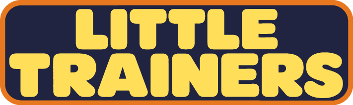
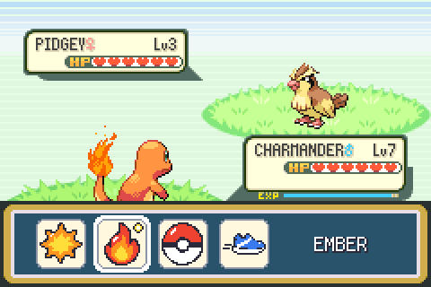

<div align="center">



# Pokémon: Little Trainers

**A preschool-friendly Pokémon FireRed modification: battles by picture, an arrow to follow,
easy catching and nothing lost by losing.**


</div>

Little Trainers adapts Pokémon FireRed for children aged three to six: a child who cannot read
should be able to choose a Pokémon, explore, catch, battle, evolve and earn badges with very little
adult help. It is a real GBA ROM hack built from the
[pret/pokefirered](https://github.com/pret/pokefirered) decompilation, and it runs on any standard
GBA emulator.

| | | |
| :---: | :---: | :---: |
|  |  |  |
| The title screen | An arrow always shows the way | Pictures to press, hearts for health |
|  |  |  |
| One press to throw a ball | Pictures in the menu | Confetti for every badge |

## What is different from FireRed
- **Battles by picture:** one or two attacks chosen for the Pokémon, shown as big buttons, with a
  small star on the one that works best. No move lists, no PP, no missing.
- **An arrow to follow** from the bedroom to the Hall of Fame. It points diagonally when either
  of two directions is right.
- **Hearts instead of numbers**, healing after every battle, and nothing lost by losing.
- **Easy catching:** balls are free and never run out. Common Pokémon are caught almost every
  time; rare ones may take a few throws.
- **No reading needed to get on:** no typing, no nickname questions, ticks and crosses on Yes/No.
- **Three modes** a parent can pick under OPTION → MODE: Little Trainer (the default), Junior
  Trainer (2.5 times easier than the original) and Classic Trainer (the original rules).

The full list is in [CHANGELOG.md](CHANGELOG.md), and the design rules in
[docs/ACCESSIBILITY.md](docs/ACCESSIBILITY.md).

**This repository contains no ROMs and no game source.** It holds only our changes (as patches),
build scripts, tests and documentation. You supply your own FireRed ROM.

## Play it: the simple way
You do not need to build anything. The download is a small patch file, not the game itself: for
legal reasons no ROM is ever shared here, so you combine the patch with your own copy of FireRed.

1. **Have your own Pokémon FireRed ROM.** It must be the **(USA, Europe) v1.1** version (also
   called Rev 1), a `.gba` file of 16,777,216 bytes.
2. **Download the patch** from the
   [latest release](https://github.com/mckenna654/pokemon-little-trainers/releases): the file ending
   in `.bps`.
3. **Put the two together** with a patcher. The easiest is
   [Rom Patcher JS](https://www.marcrobledo.com/RomPatcher.js/), which works inside a web browser on a
   computer, phone or tablet (the files stay on your device):
   - "ROM file": choose your FireRed ROM.
   - "Patch file": choose the `.bps` you downloaded.
   - Press **Apply patch** and save the new `.gba` file it gives you.
4. **Add the new file to your emulator** like any other GBA game: in mGBA use File → Load ROM; in
   Delta tap **+** and pick the file; in RetroArch use Load Content.
5. **Start a new game.** Saves from the original FireRed do not work with it.

If the patcher says the ROM is wrong, it is not v1.1: the release notes list the checksums of the
right one. Only the mGBA emulator has been tested so far; other emulators should work but have
not been checked.

## Steam Deck: install and update with one script
The installer does the steps above for you. It finds your FireRed v1.1 (or asks you to pick it),
downloads the newest patch, makes the game next to your other GBA games (EmuDeck and RetroDECK
folders are found by themselves), and remembers what it did. Run it again whenever you like: it
only does something when there is a newer patch, and it leaves your save file alone.

1. Switch to **Desktop Mode** and open **Konsole**.
2. Paste these two lines:
   ```bash
   curl -L -o ~/install-little-trainers.py https://raw.githubusercontent.com/mckenna654/pokemon-little-trainers/main/steamdeck/install-little-trainers.py
   python3 ~/install-little-trainers.py
   ```
3. Answer the pop-up windows. To update later, run the second line again.

It needs only what SteamOS already has, asks for no password, reads your original ROM without
changing it, and uploads nothing. To see the game in Gaming Mode, add it to Steam the way you add
your other emulated games (with EmuDeck, that is Steam ROM Manager). `python3
~/install-little-trainers.py --help` lists the options.

**Not yet tried on a real Steam Deck.** It has been tested on a Mac: installing, refusing wrong
ROMs, and updating from one release to the next. If it misbehaves on your Deck, the simple way
above always works.

## Build it yourself (macOS, Linux, Windows via WSL)
For changing the game, or if you would rather not use a patcher.
```bash
git clone https://github.com/mckenna654/pokemon-little-trainers.git
cd pokemon-little-trainers
scripts/setup.sh            # tools, pinned decomp source into game/, our patches applied
cp /path/to/your/firered.gba original-rom/firered-rev1.gba
scripts/verify-rom.sh       # must be FireRed (USA, Europe) v1.1
scripts/build.sh            # -> builds/Pokemon - Little Trainers.gba  and  .bps
scripts/test.sh             # unit tests + automated play-through in a headless emulator
```
Play `builds/Pokemon - Little Trainers.gba` in mGBA, RetroArch, Delta or another GBA emulator, or
apply `builds/Pokemon - Little Trainers.bps` to your own FireRed v1.1 ROM with any BPS patcher.

More: [docs/BUILD.md](docs/BUILD.md) · [docs/TESTING.md](docs/TESTING.md)

## Status
A test build: an automated player has finished the whole game using only the arrow and the A
button, but very little of it has been played by people yet. See
[docs/PROGRESS.md](docs/PROGRESS.md) for exactly what is built and how it was tested,
[docs/KNOWN_ISSUES.md](docs/KNOWN_ISSUES.md) for what is not right yet, and
[ROADMAP.md](ROADMAP.md) for what is next.

## Documents
| File | Purpose |
| --- | --- |
| [ROADMAP.md](ROADMAP.md) · [CHANGELOG.md](CHANGELOG.md) | Milestones and history |
| [docs/PROGRESS.md](docs/PROGRESS.md) | Current status, unverified items, next action |
| [docs/ARCHITECTURE.md](docs/ARCHITECTURE.md) | Repo design, source map, every change, licensing |
| [docs/ACCESSIBILITY.md](docs/ACCESSIBILITY.md) | Design rules for preschool players, parent checklist |
| [docs/GRAPHICS.md](docs/GRAPHICS.md) | Remaster strategy and asset attribution |
| [docs/BUILD.md](docs/BUILD.md) · [docs/TESTING.md](docs/TESTING.md) · [docs/KNOWN_ISSUES.md](docs/KNOWN_ISSUES.md) | Building, testing, limitations |
| [AGENTS.md](AGENTS.md) / [CLAUDE.md](CLAUDE.md) | Instructions for Claude sessions |

## Credits and legal
Pokémon and Pokémon FireRed are © Nintendo, Creatures Inc. and GAME FREAK inc. This is an unofficial,
non-commercial fan project with no affiliation. The decompilation is the work of the
[pret](https://pret.github.io/) contributors; mGBA (MPL-2.0) and Floating IPS (GPL-3.0) are used as
local build/test tools and are not redistributed. Never share ROM files.
